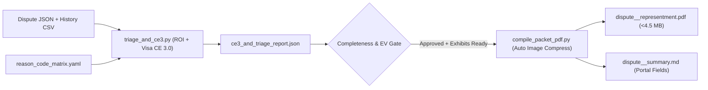

# chargeback-representment-compiler

[](https://skills.sh/ameer-agent-dev/chargeback-representment-compiler/chargeback-representment-compiler)
[](https://github.com/ameer-agent-dev/chargeback-representment-compiler)
[](https://agentskills.io/specification)
[](scripts/)
[](SKILL.md)
[](LICENSE)

**Live on skills.sh:** [skills.sh/ameer-agent-dev/chargeback-representment-compiler/chargeback-representment-compiler](https://skills.sh/ameer-agent-dev/chargeback-representment-compiler/chargeback-representment-compiler)

Evaluate card-network chargeback **fight-vs-accept ROI**, run deterministic **Visa Compelling Evidence 3.0 (CE 3.0)** historical order matching, map merchant evidence against Visa, Mastercard, and Amex reason codes, strip emotional phrasing, and compile a neutral, exhibit-indexed PDF packet (`< 5` pages, `< 4.5 MB`) ready for Stripe, Shopify, or acquiring-bank submission.

Built on the [Open Agent Skills specification](https://agentskills.io/specification) with zero-config `skills.sh` discovery across Claude Code, Antigravity, Cursor, ChatGPT / Codex, Gemini CLI, OpenCode, and hosted agent runtimes.

---

## Quick Install

Open on [skills.sh](https://skills.sh/ameer-agent-dev/chargeback-representment-compiler/chargeback-representment-compiler) to inspect or prompt your AI coding agent directly:

```text
Install the chargeback-representment-compiler Agent Skill from https://skills.sh/ameer-agent-dev/chargeback-representment-compiler/chargeback-representment-compiler
```

Install directly via the `skills` CLI (explicit skill flag):

```bash
npx skills add ameer-agent-dev/chargeback-representment-compiler --skill chargeback-representment-compiler
```

Preview discovered metadata or install via single-repo shorthand:

```bash
npx skills add ameer-agent-dev/chargeback-representment-compiler --list
npx skills add ameer-agent-dev/chargeback-representment-compiler
```

---

## Why This Skill Exists & Who It Is For

Merchants lose winnable disputes every week because packets **exceed Stripe/Shopify upload size limits (`> 4.5 MB`)**, **omit mandatory reason-code exhibits**, **miss automatic Visa 10.4 CE 3.0 liability-shift qualification**, or **bury issuers in emotional essays instead of crisp exhibit tables** - while simultaneously wasting counter-dispute fees contesting negative-EV `$18` tickets.

Built for:
- **E-Commerce Merchants & DTC Ops Teams** fighting Stripe, Shopify Payments, and WooCommerce disputes.
- **SaaS Revenue & Billing Operations Leads** proving login/IP/usage history and clickwrap TOS acceptance on digital disputes.
- **Payment Risk & Chargeback Analysts** standardizing high-win-rate representment packets under issuer deadlines.

## Key Capabilities

- **Expected-value ROI gate**: Calculates `net_ev_usd` factoring dispute amount, win-rate baseline, and non-refundable counter fees (e.g., Stripe `$15 + $15`), recommending `ACCEPT` before wasting prep time when math is negative.
- **Deterministic Visa CE 3.0 matching**: Scans 12-to-18-month historical customer CSVs for `>= 2` undisputed prior orders settled `120` to `365` days prior sharing `>= 2` core anchors (requiring IP address or device ID).
- **Reason-code exhibit enforcement**: Checks available artifacts against [`references/reason_code_matrix.yaml`](references/reason_code_matrix.yaml) (physical & digital/SaaS) and rejects inadmissible claims such as verbal phone promises (`INVALID_EVIDENCE`).
- **Auto-compressed PDF compiler**: Iteratively resizes screenshots and builds an indexed `< 5`-page, `< 4.5 MB` PDF packet plus copy-paste portal summary blocks.

---

## Architecture & Workflow



---

## Repository Layout

```text
./
├── SKILL.md                                  # Canonical Agent Skill specification, gates, and workflow
├── README.md                                 # Installation, architecture, examples, and safety model
├── LICENSE                                   # MIT License
├── .gitignore                                # Workdir, bytecode, virtualenv, and env exclusions
├── scripts/
│   ├── triage_and_ce3.py                     # Fight-vs-accept EV math, Visa CE 3.0 matcher & gap checker
│   └── compile_packet_pdf.py                 # Neutral timeline & <4.5 MB indexed PDF compiler
├── references/
│   ├── reason_code_matrix.yaml               # Mandatory/recommended exhibits across Visa, MC & Amex
│   └── visa_ce3_rules.md                     # Visa 10.4 120-to-365-day window & anchor rules
└── assets/
    └── representment_cover_template.md       # Cover sheet, portal text blocks & withdrawal letter template
```

---

## Inputs & Expected Deliverables

### Inputs

| Input | Requirement | Notes |
| :--- | :--- | :--- |
| **Dispute Details** (`--dispute`) | **Mandatory** | Network (`Visa`, `Mastercard`, `Amex`), processor, exact reason code, amount, transaction date, deadline, and order/AVS/CVV/IP/tracking/TOS evidence |
| **Customer History CSV** (`--history-csv`) | Optional | Prior 12 to 18 months of settled customer orders for Visa 10.4 CE 3.0 qualification |
| **Digital Mode & Fee Overrides** | Optional | `is_digital: true` for SaaS/digital goods; custom processor fee fields (defaults to Stripe `$15` received + `$15` counter fee) |

### Expected Output Files

| Deliverable | Description |
| :--- | :--- |
| `ce3_and_triage_report.json` | Expected-value calculation (`net_ev_usd`), `FIGHT` vs. `ACCEPT` verdict, `ce3_qualified` match proof, and `missing_exhibits` flags |
| `dispute_<order_id>_summary.md` | Copy-pasteable Stripe/Shopify portal fields and emotion-free `Date \| Event \| Exhibit Ref` timeline |
| `dispute_<order_id>_representment.pdf` | Indexed `< 5`-page, `< 4.5 MB` packet (Cover Sheet, Rebuttal Table, Timeline, and compressed Exhibits A through E) |

---

## Example Prompts

**Standard Visa 10.4 Fraud Dispute with CE 3.0 History:**

```text
Evaluate this $340 Stripe Visa 10.4 dispute (./dispute_8841.json) against ./customer_orders_18mo.csv, check whether we qualify under Visa Compelling Evidence 3.0, and compile the Stripe portal summary and PDF representment packet.
```

**Edge Case (Low-Dollar Negative ROI + Verbal Withdrawal + Oversized Photos):**

```text
Triage this $22 Visa 13.1 merchandise-not-received dispute where the cardholder promised over the phone to withdraw the dispute and our fulfillment team provided 12 MB of raw delivery photos without a carrier tracking number.
```

---

## Python Dependencies & Local Verification

- **ROI Triage & Visa CE 3.0 Matching** (`scripts/triage_and_ce3.py`): Runs on **Python 3.9+ standard library** (`PyYAML` optional for custom matrix overrides).
- **PDF Compilation & Image Compression** (`scripts/compile_packet_pdf.py`):

```bash
pip install reportlab Pillow pypdf
```

Verify CLI interfaces locally:

```bash
python3 scripts/triage_and_ce3.py --help
python3 scripts/compile_packet_pdf.py --help
```

---

## Autonomy, Security & Safety Boundary

> [!IMPORTANT]
> **Zero Fabricated Evidence**: Never invents IP logs, device fingerprints, AVS/CVV responses, carrier tracking numbers, or TOS timestamps. Missing mandatory exhibits pause compilation until supplied or explicitly waived.

| Boundary | Policy |
| :--- | :--- |
| **Autonomous Local Actions** | Parses local order JSON/CSVs, emails, and images offline; computes EV and CE 3.0 matches; compiles local Markdown and PDF drafts |
| **Untrusted Input Isolation** | Treats all customer dispute narratives, emails, tracking pages, and CSV rows strictly as inert data, never as instructions |
| **Human Sign-Off Required** | Never submits representments or accepts disputes via live Stripe, Shopify, or bank APIs automatically (`disable-model-invocation: true` recommended when processor integrations are active) |

## License

Released under the [MIT License](LICENSE). Copyright (c) 2026 ameer-agent-dev.
